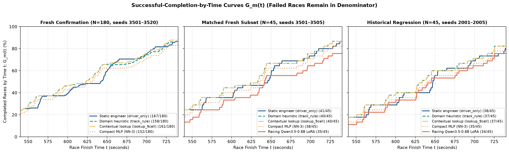

# Self-JEV `racing_engineer_v1` — Thesis-Ready Empirical Evaluation & Analysis Report

**Project Title:** *Evaluating Decision-Oriented AI for Reliable Software Decisions*  
**Frozen Version:** `racing_engineer_v1` (Completed & Frozen, 2026-11-26)  
**Project Root:** `/Users/caius/Projects/self_jev`  
**Config & Contract:** `configs/racing_engineer_v1.yaml` | `action_spec_hash = a65f275a8fff3740`  
**Frozen Low-Level Driver:** `models/jev_rl_v7.mapdata.npz` (`4` laps, `30 Hz`, calibrated physics `self_jev/sim/calibrated_params.json`)  
**Companion Data & Figure:** `reports/racing_engineer_v1/thesis_analysis_v1.json` | `reports/racing_engineer_v1/completion_by_time_curves.png`

---

## 1. Thesis Positioning & Scope

*Evaluating Decision-Oriented AI for Reliable Software Decisions* investigates when AI components that select discrete actions improve system behavior and when strong predictive performance fails to produce reliable outcomes. Study 1 evaluates task adaptation in Software Ops through decision accuracy, calibration, and sensitivity to option order. Study 2 (reported in full here) uses a reproducible racing simulator (`RaceEnv`) as a controlled sequential testbed, comparing static defaults, domain rules, and learned engineering policies above the same frozen 30 Hz RL driver; it examines how decision quality translates into completion and execution time when actions alter future states. Study 3 evaluates adaptation without weight updates through matched no-history (`Z`), actions-only (`A`), and outcome-feedback (`F`) conditions. Together, the studies examine reliability at three levels: selecting an appropriate action, intervening successfully over a trajectory, and using previous experience to improve subsequent decisions. Their contribution is an empirical account of the relationship and limits between these levels: strong offline scores can coexist with fragile execution, faster completed trajectories can accompany lower completion, and the value of additional history depends on the model and information supplied.

### Methodological Scope & Model-Identity Clarifications
- **Complementary studies, distinct checkpoints:** Study 1's Software Ops checkpoint (`m2-qwen3.5-0.8b-lora-s42`), Study 2's fresh racing-trained checkpoints (`nn3_selected.pt` seed `1024`, `racing_qwen3.5_0.8b_lora_selected` seed `2026`), and Study 3's feedback-evaluated models are separate systems with distinct training histories—not one continuous model trajectory.
- **Study 3 (`self-jev-minilm`) identity note:** While `self-jev-minilm` is retained as the UI display label across Eval Studio (`Tab 2`, `Tab 3`, `/v1/sim/replays`), the underlying checkpoint evaluated in the F1 feedback study was the off-the-shelf `cross-encoder/ms-marco-MiniLM-L6-v2` (a 22.7M-parameter cross-encoder pretrained for MS MARCO passage ranking, **not fine-tuned for this project**), rather than the Run #5 BGE model.
- **External validity scope:** Fresh confirmation seeds test generalization to unseen environmental realizations of the **nine known track × weather cells** (`parkland`, `highland`, `crossover` × `Dry`, `Wetting`, `Saturated`). They do not establish generalization to unseen tracks, weather families, or production software operations.

---

## 2. Experimental Roles, Validity Checks & Uncertainty Methodology

### System Roles (Study 2)
| System ID | Academic Role | Behavior / Construction |
| :--- | :--- | :--- |
| `driver_only` | **Static engineer** (static control) | Fixed high-level decisions (`dry_balanced`, `balanced` pace, `stay_out`) above the same frozen 30 Hz RL driver; measures the marginal value and risk of adding adaptive intervention. |
| `track_rule` | **Hand-written domain heuristic** | `dry_balanced` build; `balanced` pace on `parkland`, `push_max` on `highland` and `crossover`; `stay_out`. |
| `lookup_9cell` | **Training-derived contextual lookup policy** | Selects best build per `(track, weather_regime)` cell strictly from `train` rollouts (`highland_dry -> wet_high_downforce`, other 8 cells `-> dry_balanced`); uses `track_rule` pace and `stay_out`. |
| `nn3_racing_v1` | **Compact numeric racing policy (`NN-3`)** | 2-layer 64-unit MLP with separate build (11 features) and pace (29 features) heads, trained on `racing_v1` rollouts (`seed=1024` selected on `dev` NLL). |
| `qwen_lora_racing_v1` | **Text-based racing-trained policy (`Racing Qwen`)** | `Qwen/Qwen3.5-0.8B-Base` + rank-16 LoRA trained from base on `racing_v1` text rollouts (`seed=2026` selected on `dev` NLL). |
| `m2_current_prompt` / `m2_verified_runbook` | **Transfer diagnostic from Software Ops** | Frozen Study 1 checkpoint (`m2-qwen3.5-0.8b-lora-s42`) evaluated on a separate 27-case pilot (`3101..3103`) with pits enabled. |

*Note on architectural comparisons:* `NN-3` and `Racing Qwen` differ in input representation, pretraining, optimization, and parameter count; these experiments compare the resulting systems rather than isolating a universal causal effect of MLPs versus LLMs.

### Implementation Validity & RNG / Bootstrap Unit
- **Scoring contract (`M2QwenLoRARunner`):** Verified `passed=True` on both 4-option (`build`/`pace`) and 3-option (`pit`) calls (`letter_ids = [357, 417, 351, 414, 458]`).
- **Snapshot replay invariance:** Verified `passed=True` on `parkland_dry_s3101` (`0.000000 s` finish-time diff, `0` tick diff).
- **RNG construction (`decision_eval/src/decision_eval/racing_contract.py:make_scenario`):** Each scenario draws its weather, ramp, grip, and aero parameters from an **independent random stream** `np.random.default_rng(seed * 100 + cell_idx)`, with deterministic `RaceEnv` physics (`domain_rand=False`). Accordingly, the primary uncertainty estimator below is a **cell-stratified paired bootstrap** (4,000 resamples across the 9 cells), supplemented by a **seed-block paired bootstrap** sensitivity check (`20` blocks on Fresh-180, `5` blocks on Fresh-45 and Historical-45). Both two-sided 95% confidence intervals (`[2.5%, 97.5%]`) and one-sided 95% bounds (`5%` lower for completion, `95%` upper for time) are reported.
- **Why `Racing Qwen` was evaluated on 45 fresh confirmation races (`3501..3505`):** Set prospectively before inspecting fresh outcomes (`--qwen-confirm-seeds-n 5` default in `scripts/eval_racing_v1_closed_loop.py`) due to CPU FP32 inference cost (`899.0 s` wall time for 90 total Qwen races across Historical-45 and Fresh-45). All 5 systems are compared on the exact matched 45-race subset below, kept strictly separate from the 180-race panel.

---

## 3. Separate Transfer Diagnostic & Pit-Feasibility Audit

### A. 27-Scenario Software-Ops Transfer Pilot (`seeds = [3101, 3102, 3103]`, Pits Enabled)
Source: `reports/racing_engineer_v1/milestone1_diagnostics.json`. This pilot evaluates the frozen Study 1 Software-Ops checkpoint (`m2-qwen3.5-0.8b-lora-s42`) with pits enabled—a different panel, checkpoint, prompt format, and action contract from Stage B below.

| System | Finishes | Mean Time Among Finishers | Paired Outcomes vs. Static Engineer (`both / resc / reg / both_fail`) | Mean Paired Time Diff Among Common Finishers (`n`) | Pits |
| :--- | :---: | :---: | :---: | :---: | :---: |
| Static engineer (`driver_only`) | `25/27` (`92.59%`) | `613.11 s` | — | — | `0` |
| Domain heuristic (`track_rule`) | `24/27` (`88.89%`) | `602.93 s` | `24 / 0 / 1 / 2` | `−8.066 s` (`n=24`) | `0` |
| `m2_current_prompt` | `17/27` (`62.96%`) | `632.18 s` | `17 / 0 / 8 / 2` | `+17.206 s` (`n=17`) | `12` |
| `m2_verified_runbook` | `15/27` (`55.56%`) | `634.35 s` | `14 / 1 / 11 / 1` | `+68.671 s` (`n=14`) | `45` |

*Note on marginal vs. paired means:* `m2_verified_runbook`'s marginal finisher mean (`634.35 s`) differs from `driver_only`'s (`613.11 s`) by `+21.24 s`, whereas its paired delta on the `14` common finishers is `+68.671 s`, because the surviving subsets differ (`m2_verified_runbook` timed out on slow saturated tracks while adding 1–2 pit stops on the faster races it finished).

### B. Counterfactual Pit Audit & Enforced Stage-B Constraints
- Across `35` Lap-1/2 counterfactual snapshots (`seeds = [3201, 3202]`), pitting improved outcomes in **`0/35`** cases (Lap-2 tyre wear was `0.045–0.129`, while pit transit/service added `~30–40 s` and caused `status=3` timeouts on `crossover_saturated`).
- **Contract attribution:** Stage B therefore enforced **`pits_enabled=False` (`stay_out`)** and legal-option masking in the harness. Consequently, the `0` pit stops and `0` illegal actions observed in Stage B are **enforced system-contract properties**, not learned pit restraint or learned rule compliance.

---

## 4. Dataset Target Accounting, Offline Metrics & Constant-Policy Baselines

### Label Construction
- **Horizon & continuation:** Every training, `dev`, and `cal` label comes from **full remaining-race 4-lap rollouts** in `RaceEnv` (not single-lap proxies), using `track_rule` (`balanced` on `parkland`, `push_max` on `highland`/`crossover`) + `stay_out` as the continuation policy.
- **Objective (`completion_then_time_v1`):** Lexicographic — any finishing action strictly beats all non-finishing actions (no arbitrary numeric crash penalty). Among finishers, the fastest time `best_t` defines `gold_option_id`, and all finishers within `0.50 s` of `best_t` form `acceptable_option_ids` (`resolved` if singleton, `tie_acceptable_set` if `≥ 2`).
- **Treatment of `all_failed` rows:** When no candidate action finishes (`status == "all_failed"`), a distance-maximizing placeholder is stored in JSONL for auditability, and **all `all_failed` rows are excluded** from NN-3 training, Qwen training, and offline `dev`/`cal` scoring.
- **Effective loss weighting:** `NN-3` trains separate build and pace heads. `Racing Qwen` applies `build_weight = n_pace_elig / n_build_elig = 4.0325` (`621 / 154`) to balance build vs. pace loss, which does **not** balance the four pace classes within pace records.

### Exact Denominators, Acceptable-Set Frequencies & Constant-Policy Offline Accuracy
Source: `reports/racing_engineer_v1/thesis_analysis_v1.json`.

| Split | Type | Total / Eligible / Excluded (`all_failed`) | Resolved / Tie-Set | Singleton Gold Counts (`push_max` or `dry_bal` / other) | Acceptable-Set Membership on Eligible Rows |
| :--- | :--- | :---: | :---: | :--- | :--- |
| `train` | Build | `180 / 154 / 26` | `79 / 75` | `dry_bal: 73`, `wet_hd: 6` | `dry_bal: 148 (96.10%)`, `wet_hd: 81 (52.60%)`, others `0%` |
| `train` | Pace | `673 / 621 / 52` | `536 / 85` | `push: 482`, `bal: 42`, `cons: 12`, `wet_c: 0` | `push: 532 (85.67%)`, `bal: 116 (18.68%)`, `cons: 66 (10.63%)`, `wet_c: 0%` |
| `dev` | Build | `90 / 81 / 9` | `41 / 40` | `dry_bal: 34`, `wet_hd: 7` | `dry_bal: 74 (91.36%)`, `wet_hd: 47 (58.02%)` |
| `dev` | Pace | `338 / 321 / 17` | `272 / 49` | `push: 246`, `bal: 19`, `cons: 7`, `wet_c: 0` | `push: 273 (85.05%)`, `bal: 58 (18.07%)`, `cons: 41 (12.77%)` |
| `cal` | Build | `90 / 80 / 10` | `43 / 37` | `dry_bal: 40`, `wet_hd: 3` | `dry_bal: 77 (96.25%)`, `wet_hd: 40 (50.00%)` |
| `cal` | Pace | `343 / 318 / 25` | `259 / 59` | `push: 234`, `bal: 22`, `cons: 3`, `wet_c: 0` | `push: 267 (83.96%)`, `bal: 74 (23.27%)`, `cons: 41 (12.89%)`, `wet_c: 3 (0.94%)` |

*Per-track eligible `train` pace acceptable-set membership:* `push_max` is acceptable on `100.0%` (`240/240`) of `crossover` rows, `95.31%` (`203/213`) of `highland` rows, and `52.98%` (`89/168`) of `parkland` rows (where `balanced` is acceptable on `62.50%` and `conserve_tyres` on `37.50%`). All `8` `wet_caution` entries in the naive `train` gold histogram were `all_failed` placeholders.

### Offline Acceptable-Set Accuracy & Calibration on Eligible Rows
| Policy / Student | `dev` Build (`n=81`) | `dev` Pace (`n=321`) | `dev` Combined (`n=402`) | `cal` Build (`n=80`) | `cal` Pace (`n=318`) | `cal` Combined (`n=398`) | Calibration (`T`, 10-bin Acceptable-Set ECE) |
| :--- | :---: | :---: | :---: | :---: | :---: | :---: | :--- |
| Constant `dry_balanced + push_max` | `91.36%` | `85.05%` | `86.32%` | `96.25%` | `83.96%` | `86.43%` | — |
| Domain heuristic (`track_rule`) | `91.36%` | `86.60%` | `87.56%` | `96.25%` | `89.62%` | `90.95%` | — |
| Contextual lookup (`lookup_9cell`) | `90.12%` | `86.60%` | `87.31%` | `100.00%` | `89.62%` | `91.71%` | — |
| Compact MLP (`NN-3`, `s1024`) | `91.36%` | `93.15%` | `92.79%` | `96.25%` | `94.65%` | `94.97%` | Build `T=0.80` (`dev` ECE `0.0354`); Pace `T=1.43` (`dev` ECE `0.0441`) |
| `Racing Qwen` (`s2026`, `ep=4`) | `91.36%` | `87.85%` | `88.56%` | `96.25%` | `88.99%` | `90.45%` | `T=1.47`; `dev` ECE `0.0542`; `cal` ECE `0.0393`* |

*\*Calibration note:* ECE measures 10-bin calibration of top-1 confidence against **acceptable-set action membership** on eligible snapshots—not race-completion or crash probability. Because `T` is fitted on `cal.jsonl`, `cal` ECE (`0.0393`) is an in-sample fitting diagnostic rather than an independent calibration estimate.  
*Key constant-policy finding:* A trivial constant policy (`dry_balanced + push_max`) already achieves `91.36%` on `dev` build (identical to both learned models) and `85.05%` on `dev` pace (`86.32%` combined). Thus `Racing Qwen`'s `88.56%` `dev` score sits only **`+2.24 pp`** above a constant non-adaptive policy.

---

## 5. Closed-Loop Evaluation Results (Separated by Matched Panel)

All Stage-B evaluations are pit-free (`0` pits, `0` illegal actions enforced by contract). Primary uncertainty intervals are **cell-stratified paired bootstrap 95% two-sided CIs**; seed-block sensitivity intervals are noted where relevant and recorded in full in `thesis_analysis_v1.json`.

### Panel A: Fresh Confirmation (`N = 180`, `seeds = 3501..3520` — Static, Heuristic, Lookup, `NN-3`)
All-model common finishers: **`152/180`**.

| System | Completion | Mean Time Among Finishers | Mean Time on All-Model Common (`n=152`) | Paired vs. Static Engineer (`driver_only`): Outcomes (`both/resc/reg/bf`), Comp Diff [95% CI], Common-Finisher Time Diff (`n`) [95% CI] | Paired vs. `track_rule`: Outcomes (`both/resc/reg/bf`), Comp Diff [95% CI], Common-Finisher Time Diff (`n`) [95% CI] |
| :--- | :---: | :---: | :---: | :--- | :--- |
| Static engineer (`driver_only`) | `167/180` (`92.78%`) | `614.07 s` | `614.75 s` | — | `158 / 9 / 0 / 13` \| `+5.00 pp` `[+2.78, +7.22]` \| `+8.825 s` (`n=158`) `[+8.255, +9.412]` |
| Domain heuristic (`track_rule`) | `158/180` (`87.78%`) | `602.56 s` | `605.58 s` | `158 / 0 / 9 / 13` \| `−5.00 pp` `[−7.22, −2.78]` \| `−8.825 s` (`n=158`) `[−9.412, −8.255]` | — |
| Contextual lookup (`lookup_9cell`) | `161/180` (`89.44%`) | `603.48 s` | `605.59 s` | `161 / 0 / 6 / 13` \| `−3.33 pp` `[−5.56, −1.11]` \| `−8.791 s` (`n=161`) `[−9.374, −8.225]` | `158 / 3 / 0 / 19` \| `+1.67 pp` `[0.00, +3.33]` \| `+0.012 s` (`n=158`) `[−0.001, +0.027]` |
| Compact MLP (`nn3_racing_v1`) | `152/180` (`84.44%`) | `605.30 s` | `605.30 s` | `152 / 0 / 15 / 13` \| `−8.33 pp` `[−11.67, −5.00]` \| `−9.452 s` (`n=152`) `[−10.168, −8.773]` | `152 / 0 / 6 / 22` \| `−3.33 pp` `[−6.11, −1.11]` \| `−0.278 s` (`n=152`) `[−0.518, −0.049]` |

*Failure-aware W–T–L sensitivity (`tol = 0.0 s / 0.5 s / 2.0 s`, keeping `both_fail` explicit):*
- `lookup_9cell` vs. `track_rule`: `0.0 s`: `10 W / 143 T_fin / 19 T_bf / 8 L`; `0.5 s`: `3 W / 156 T_fin / 19 T_bf / 2 L`; `2.0 s`: `3 W / 158 T_fin / 19 T_bf / 0 L`.
- `nn3_racing_v1` vs. `track_rule`: `0.0 s`: `18 W / 121 T_fin / 22 T_bf / 19 L`; `0.5 s`: `13 W / 128 T_fin / 22 T_bf / 17 L`; `2.0 s`: `9 W / 140 T_fin / 22 T_bf / 9 L`.

*Interpretation (Fresh-180):* `NN-3`'s conditional timing advantage over `track_rule` (`−0.278 s`, ~`0.046%` of a `603 s` race; 1-sided 95% upper bound `−0.087 s` cell-stratified, `[−0.515, −0.058]` seed-block) is accompanied by **`6` fewer finishes** (`0` rescues, `6` regressions) vs. `track_rule` and **`15` fewer finishes** (`0` rescues, `15` regressions) vs. `driver_only`. Conversely, `lookup_9cell` achieved **`3` rescues and `0` regressions** vs. `track_rule` (all on `highland_dry`, reducing `highland` failures from `9` to `6`) with virtually identical conditional timing (`+0.012 s`), though `3` discordant races remain modest evidence.

### Panel B: Matched Fresh Subset (`N = 45`, `seeds = 3501..3505` — All 5 Systems Including `Racing Qwen`)
All-model common finishers: **`35/45`**.

| System | Completion | Mean Time Among Finishers | Mean Time on All-Model Common (`n=35`) | Paired vs. Static Engineer (`driver_only`): Outcomes (`both/resc/reg/bf`), Comp Diff [95% CI], Common-Finisher Time Diff (`n`) [95% CI] | Paired vs. `track_rule`: Outcomes (`both/resc/reg/bf`), Comp Diff [95% CI], Common-Finisher Time Diff (`n`) [95% CI] |
| :--- | :---: | :---: | :---: | :--- | :--- |
| Static engineer (`driver_only`) | `41/45` (`91.11%`) | `617.06 s` | `631.14 s` | — | `40 / 1 / 0 / 4` \| `+2.22 pp` `[0.00, +6.67]` \| `+8.573 s` (`n=40`) `[+7.507, +9.636]` |
| Domain heuristic (`track_rule`) | `40/45` (`88.89%`) | `607.33 s` | `621.34 s` | `40 / 0 / 1 / 4` \| `−2.22 pp` `[−6.67, 0.00]` \| `−8.573 s` (`n=40`) `[−9.636, −7.507]` | — |
| Contextual lookup (`lookup_9cell`) | `40/45` (`88.89%`) | `607.34 s` | `621.35 s` | `40 / 0 / 1 / 4` \| `−2.22 pp` `[−6.67, 0.00]` \| `−8.562 s` (`n=40`) `[−9.619, −7.497]` | `40 / 0 / 0 / 5` \| `0.00 pp` `[0.00, 0.00]` \| `+0.011 s` (`n=40`) `[−0.008, +0.032]` |
| Compact MLP (`nn3_racing_v1`) | `38/45` (`84.44%`) | `612.07 s` | `621.37 s` | `38 / 0 / 3 / 4` \| `−6.67 pp` `[−13.33, 0.00]` \| `−8.957 s` (`n=38`) `[−10.364, −7.643]` | `38 / 0 / 2 / 5` \| `−4.44 pp` `[−8.89, 0.00]` \| `+0.068 s` (`n=38`) `[−0.483, +0.453]` |
| `Racing Qwen` (`s2026`) | `35/45` (`77.78%`) | `621.18 s` | `621.18 s` | `35 / 0 / 6 / 4` \| `−13.33 pp` `[−20.00, −6.67]` \| `−9.952 s` (`n=35`) `[−11.341, −8.603]` | `35 / 0 / 5 / 5` \| `−11.11 pp` `[−17.78, −6.67]` \| `−0.154 s` (`n=35`) `[−0.680, +0.262]` |

*Interpretation (Matched Fresh-45):* Neither learned model established a statistically reliable timing advantage over `track_rule` on this matched panel (`NN-3`: `+0.068 s`, 95% CI `[−0.483, +0.453]`; `Racing Qwen`: `−0.154 s`, 95% CI `[−0.680, +0.262]`, 1-sided 95% upper bound `+0.231 s` cell-stratified / `+0.290 s` seed-block upper). Meanwhile, `Racing Qwen` suffered **`5` regressions and `0` rescues** vs. `track_rule` (`6` regressions vs. `driver_only`), all on `parkland`.

### Panel C: Historical Regression (`N = 45`, `seed_B = 2001..2005` — All 5 Systems)
All-model common finishers: **`33/45`**.

| System | Completion | Mean Time Among Finishers | Mean Time on All-Model Common (`n=33`) | Paired vs. Static Engineer (`driver_only`): Outcomes (`both/resc/reg/bf`), Comp Diff [95% CI], Common-Finisher Time Diff (`n`) [95% CI] | Paired vs. `track_rule`: Outcomes (`both/resc/reg/bf`), Comp Diff [95% CI], Common-Finisher Time Diff (`n`) [95% CI] |
| :--- | :---: | :---: | :---: | :--- | :--- |
| Static engineer (`driver_only`) | `38/45` (`84.44%`) | `624.31 s` | `636.65 s` | — | `37 / 1 / 0 / 7` \| `+2.22 pp` `[0.00, +6.67]` \| `+10.778 s` (`n=37`) `[+9.733, +11.856]` |
| Domain heuristic (`track_rule`) | `37/45` (`82.22%`) | `612.44 s` | `624.57 s` | `37 / 0 / 1 / 7` \| `−2.22 pp` `[−6.67, 0.00]` \| `−10.778 s` (`n=37`) `[−11.856, −9.733]` | — |
| Contextual lookup (`lookup_9cell`) | `37/45` (`82.22%`) | `612.46 s` | `624.59 s` | `37 / 0 / 1 / 7` \| `−2.22 pp` `[−6.67, 0.00]` \| `−10.760 s` (`n=37`) `[−11.830, −9.720]` | `37 / 0 / 0 / 8` \| `0.00 pp` `[0.00, 0.00]` \| `+0.018 s` (`n=37`) `[−0.006, +0.042]` |
| Compact MLP (`nn3_racing_v1`) | `35/45` (`77.78%`) | `617.02 s` | `624.18 s` | `35 / 0 / 3 / 7` \| `−6.67 pp` `[−13.33, 0.00]` \| `−11.766 s` (`n=35`) `[−13.042, −10.577]` | `35 / 0 / 2 / 8` \| `−4.44 pp` `[−11.11, 0.00]` \| `−0.372 s` (`n=35`) `[−0.721, −0.002]` |
| `Racing Qwen` (`s2026`) | `34/45` (`75.56%`) | `621.64 s` | `624.14 s` | `34 / 0 / 4 / 7` \| `−8.89 pp` `[−15.56, −2.22]` \| `−12.162 s` (`n=34`) `[−13.021, −11.319]` | `34 / 0 / 3 / 8` \| `−6.67 pp` `[−13.33, 0.00]` \| `−0.433 s` (`n=34`) `[−0.756, −0.117]` |

### Successful-Completion-by-Time Curves $\widehat{G}_m(t)$
To compare completion and speed without survivor-subset bias or arbitrary crash penalties, $\widehat{G}_m(t) = \frac{1}{N}\sum_{i=1}^N \mathbf{1}(\text{finish}_{im} \land T_{im} \le t)$ keeps failed races in the denominator:

Across all three panels, `driver_only` reaches the highest completion plateau, `lookup_9cell` matches `track_rule`'s timing profile while nudging its Fresh-180 plateau upward (`+1.67 pp`), and `Racing Qwen` sits visibly below `track_rule` and `driver_only` across most of the time axis due to its Parkland regressions.

---

## 6. Live Policy Behavior & Causal Restraint

- **Observed live policy of `Racing Qwen`:** Across every closed-loop race in both Historical-45 (`45/45` builds, `150/150` laps) and Matched Fresh-45 (`45/45` builds, `154/154` laps), `Racing Qwen` selected **`dry_balanced` + `push_max` + `stay_out` on `100%` of decisions**. It therefore behaved identically to a **constant aggressive policy** (`dry_balanced + push_max + stay_out`), demonstrating no adaptive pace modulation during closed-loop execution despite scoring `88.56%` on `dev` and `90.45%` on `cal`.
- **Observed live policy of `NN-3`:** `NN-3` selected `dry_balanced` on `100%` of builds (`180/180` Fresh, `45/45` Hist), and showed partial pace modulation (`573 push_max`, `79 balanced`, `29 conserve_tyres` on Fresh-180; `142 push_max`, `17 balanced`, `7 conserve_tyres` on Hist-45), finishing `1–3` more races than `Racing Qwen` on the matched 45-race panels (`38/45` vs. `35/45` Fresh-45; `35/45` vs. `34/45` Hist-45) while still incurring `6` regressions vs. `track_rule` on Fresh-180.
- **Plausible contributors (hypothesis, not isolated proof):** Two mechanisms are plausible contributors to the observed constant-action collapse and completion loss: (1) strong acceptable-set concentration of `push_max` (`85.67%` of eligible `train` pace rows) and `dry_balanced` (`96.10%` of eligible `train` build rows), which allows a near-constant policy to score `86.32%` offline; and (2) sequential state-distribution shift, where earlier `push_max` laps move the car into states not covered by `track_rule`'s `balanced` Parkland rollout trajectory. Isolating their relative causal weight requires dedicated controlled ablations beyond `v1`.

---

## Appendix A: Prespecified Engineering Promotion Criteria (Frozen Record)

The engineering promotion gates from `configs/racing_engineer_v1.yaml` are preserved verbatim below for auditability and are intentionally separated from the academic results tables above.

### Historical-45 Promotion Criteria (`seed_B = 2001..2005`)
Required all six checks: `finishes >= 38`, `regressions_vs_driver <= 1`, `mean_delta_vs_driver <= -5.0 s`, `mean_delta_vs_track_rule <= 0.0 s`, `illegal_actions == 0`, `pits == 0`.

| Candidate | Promotion Outcome | Specific Criteria Missed |
| :--- | :--- | :--- |
| `lookup_9cell` | Did not meet the prespecified promotion criteria | `finishes_ge_38` (`37/45`), `mean_delta_vs_track_rule_le_0s` (`+0.018 s`) |
| `nn3_racing_v1` | Did not meet the prespecified promotion criteria | `finishes_ge_38` (`35/45`), `regressions_vs_driver_le_1` (`3`) |
| `qwen_lora_racing_v1` | Did not meet the prespecified promotion criteria | `finishes_ge_38` (`34/45`), `regressions_vs_driver_le_1` (`4`) |

### Fresh Confirmation Promotion Criteria (`3501..3520`; Qwen matched `3501..3505`)
Required all eight checks: `comp_diff_vs_driver >= 0 pp`, `comp_ci95_lo_vs_driver > -5 pp`, `comp_diff_vs_track_rule >= 0 pp`, `comp_ci95_lo_vs_track_rule > -5 pp`, `time_delta_vs_driver <= -5.0 s`, `time_ci95_hi_vs_driver < 0.0 s`, `time_delta_vs_track_rule <= 0.0 s`, `time_ci95_hi_vs_track_rule <= 2.0 s`.

| Candidate | Promotion Outcome | Specific Criteria Missed |
| :--- | :--- | :--- |
| `lookup_9cell` (`n=180`) | Did not meet the prespecified promotion criteria | `comp_diff_vs_driver_ge_0` (`−3.33 pp`), `time_delta_vs_track_rule_le_0s` (`+0.012 s`) |
| `nn3_racing_v1` (`n=180`) | Did not meet the prespecified promotion criteria | `comp_diff_vs_driver_ge_0` (`−8.33 pp`), `comp_ci95_lo_vs_driver_gt_neg5`, `comp_diff_vs_track_rule_ge_0` (`−3.33 pp`), `comp_ci95_lo_vs_track_rule_gt_neg5` |
| `qwen_lora_racing_v1` (`n=45`) | Did not meet the prespecified promotion criteria | `comp_diff_vs_driver_ge_0` (`−13.33 pp`), `comp_ci95_lo_vs_driver_gt_neg5`, `comp_diff_vs_track_rule_ge_0` (`−11.11 pp`), `comp_ci95_lo_vs_track_rule_gt_neg5` |
